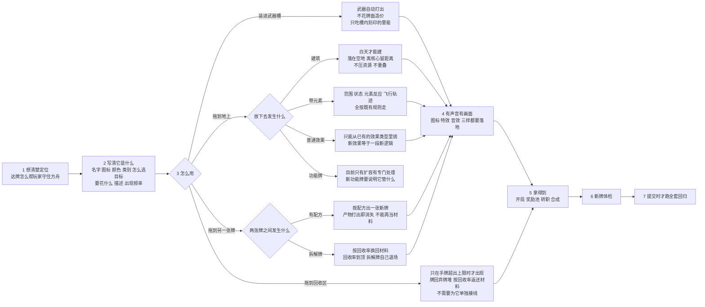

# 做一张新卡牌的流程

## 每一步在问什么

1. **定位**：清潮、控场、修核心、保资源、循环抽牌，它补哪一环。
2. **卡面**：玩家在手里看到的那几行字，就是这张牌的全部信息。
3. **怎么用**：装武器、拖到地上、拖到另一张牌上、拖到回收区。四种是同一批牌的四种去处，不是四类牌；其中回收区只在手牌超出上限时才出现。
4. **效果**：能不能塞进现有效果类型；塞不进就是新机制，要单独说。
5. **视听**：漏了不报错，只是打出去没反应。
6. **来源**：拿不到的牌等于没做。
7. **验证**：改动中只跑体检；全套回归和提交留到发话或提交前。

## 现在有哪些特殊牌

按「哪一处不是默认」分组：

| 特殊在哪 | 现在有谁 |
| --- | --- |
| 只能装武器，不能落地 | 锋锐、迅捷、回响（数值）；二重法术、二叉、三叉（改同一发法术的形态） |
| 要拖到另一张牌上 | 拆解·微光、拆解·熔解、拆解·归墟 |
| 只能靠合成得到，打出即消失 | 霜火交攻、烬纹、霜纹、凝神、陨星雨、生生不息 |
| 用掉就从牌库消失 | 拆解三张（回收率到顶）、扩容（手牌满上限）、法师（转职后清掉） |
| 手牌超限才有的去处 | 任何一张牌都能拖进右下回收区，换回材料，牌回弃牌堆 |
| 法师限定，非法师拿不到 | 法力之井，最多同时 3 座 |
| 不进奖励池，只靠转职发 | 烈焰冲击、火焰引爆、暴风雪、冰封之环、魔法飞弹 |
| 根本不是牌 | 火球、冰锥、奥术弹——武器的基础攻击模板，不会出现在手里 |

新牌落到这张表的任何一行，就说明它要在默认流程之外多做一件事。

## 体检拦不住什么

- 打了没特效（写漏了分支，不报错）
- 短描述缺失（会静默回落到长描述）
- 手感和数值平衡
- 设计定位是否成立

这四项只能人看。具体落到哪段逻辑的可对照表在 `.workbuddy/skills/ark-card-wizard/references/wiring.md`。
